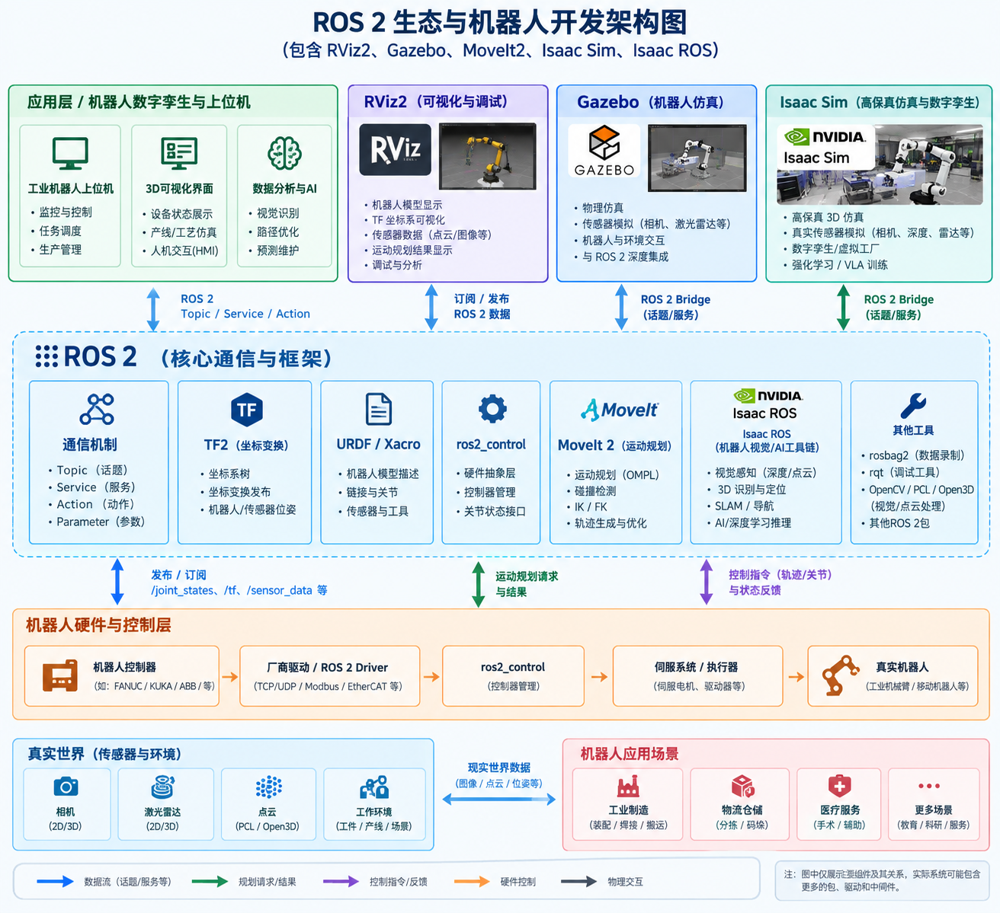

## 概述

+ ROS 2 = 操作系统/通信生态
+ RViz2 = 看机器人
+ TF2 = 管坐标系
+ URDF = 描述机器人
+ MoveIt 2 = 算机器人怎么运动
+ ros2_control = 控制机器人硬件
+ Gazebo/Isaac Sim = 模拟机器人和环境
+ OpenCV/PCL/Open3D = 看懂现实世界

## DDS

DDS(Data Distribution Service) 共享数据模型和数据总线 Shared Data Model + DataBus 在ROS架构中其他部件均建设在DDS之上 topic的通讯实现依赖于DDS

## Colcon

Colcon(Collective Construction) ROS2 构建工具

## Rviz

RViz 可以简单理解成 ROS 世界里的“机器人数据可视化器”。与ISaac Sim不是上下级关系，而是可以互相配合。

例如：

                    ROS 2
                      │
          ┌───────────┴───────────┐
          │                       │
       RViz2                  Isaac Sim
    数据可视化                机器人仿真
          ▲                       │
          │                       │
          └────── ROS 2 ──────────┘

Isaac Sim 可以通过 ROS 2 Bridge 发布机器人状态、相机、激光雷达、点云等数据。

于是：

Isaac Sim 负责“模拟机器人世界”，RViz2 负责“看 ROS 数据”。

## Moveit